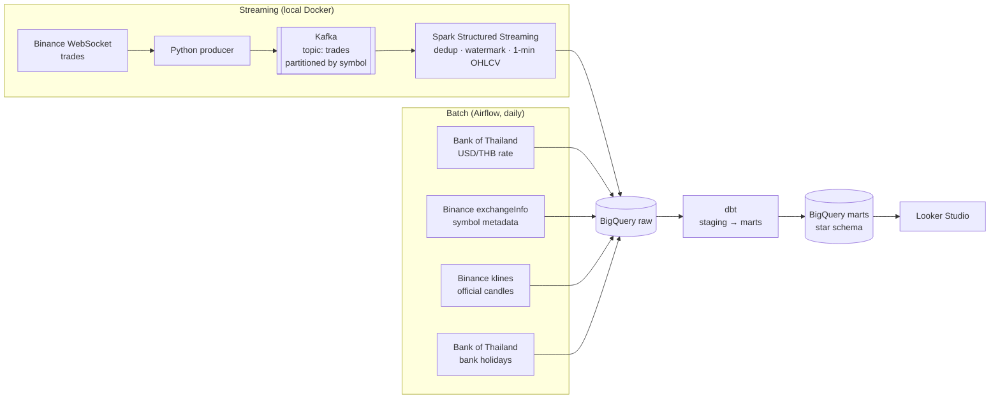

# Crypto Market Data Platform (in THB)

Streaming and batch pipeline for crypto market data, priced in Thai baht. Live trades from Binance flow through Kafka and Spark Structured Streaming into 1-minute candles; daily batch jobs bring in reference data and the Bank of Thailand USD/THB rate; dbt models it all into a star schema in BigQuery.

> **Status: planning.** Data sources are checked and the design is below. Nothing is built yet; see [Progress](#progress).

## Architecture



Infrastructure on GCP is created with Terraform. Every pull request runs SQL lint, unit tests and `dbt build` in GitHub Actions.

## Data sources

All checked before starting, so the pipeline is not built on a source that returns placeholder data.

| Source | What | Access | Checked |
|---|---|---|---|
| Binance WebSocket `data-stream.binance.vision` | Every trade, real time | Public, no key | 96 BTCUSDT trades in 10 seconds |
| Binance REST `exchangeInfo`, `klines` | Symbol status and rules, official 1-minute candles | Public, no key | |
| Bank of Thailand `gateway.api.bot.or.th` | Daily USD/THB rate, financial institution holidays | Free key from [portal.api.bot.or.th](https://portal.api.bot.or.th/), `Authorization` header | Endpoint answers 401 without a key, as expected |

## Planned data model

```
                 dim_symbol (SCD Type 2)
                 status, tick size, base/quote asset
                          │
dim_date ─────── fct_candles_1m ─────── dim_time
(Thai bank        symbol, minute,        (minute of day,
 holidays)        open/high/low/close,    trading session)
                  volume, trade count
                          │
                 fct_fx_daily (USD/THB)
```

- `fct_candles_1m` is incremental and merges on `(symbol, minute)`, so replaying the stream does not duplicate rows.
- `dim_symbol` is a dbt snapshot of `exchangeInfo`. Symbols really do change: trading halts, tick size changes, delistings.
- Marts on top: daily OHLCV in baht, rolling volatility, VWAP, daily ranking by volume.

## Data quality plan

- **Stream vs exchange reconciliation.** Compare every candle built from the stream with Binance's official candle for the same minute, and explain the minutes that differ (disconnects, events later than the watermark, duplicates).
- Gaps: minutes with no candle for a symbol that was trading.
- Freshness: alert when the latest candle or FX rate is older than expected.
- dbt tests on every layer: unique keys, not null, relationships, value ranges.
- Kafka consumer lag.

## Progress

- [ ] Kafka in Docker, producer from the Binance WebSocket
- [ ] Spark Structured Streaming: dedup, watermark, 1-minute candles to BigQuery
- [ ] Airflow batch: FX rate, holidays, exchangeInfo, klines
- [ ] dbt: staging, star schema, snapshot, tests
- [ ] Stream vs exchange reconciliation
- [ ] Terraform for GCP
- [ ] GitHub Actions CI
- [ ] Dashboard

## Stack

Kafka · Spark Structured Streaming · Python · Apache Airflow · dbt · BigQuery · Terraform · GitHub Actions · Docker · Looker Studio
