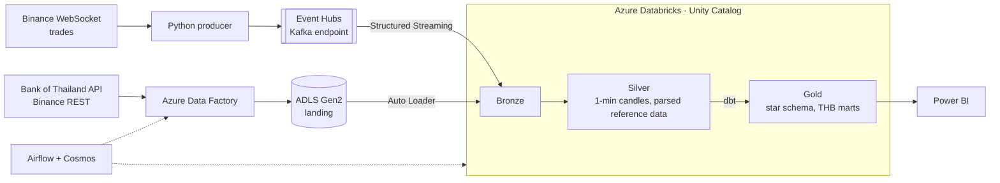

# Crypto Market Lakehouse (in THB) on Azure Databricks

Streaming and batch lakehouse for crypto market data, priced in Thai baht. Live trades from Binance go through Kafka (the Azure Event Hubs Kafka endpoint) into Databricks Structured Streaming and become 1-minute candles. Daily jobs in Azure Data Factory bring in the Bank of Thailand USD/THB rate and bank holidays, plus Binance reference data and official candles. Everything lands in a Bronze/Silver/Gold Delta lakehouse governed by Unity Catalog; dbt builds the Gold star schema, Airflow with Cosmos orchestrates the whole flow, and Power BI reads the result.

> **Status: planning.** Data sources are checked and the design is below. Nothing is built yet; see [Progress](#progress).

## Architecture



- **Streaming:** producer → Event Hubs → Bronze (raw messages) → Silver (deduplicated, event-time 1-minute candles with a watermark). Runs as scheduled `availableNow` jobs instead of an always-on cluster.
- **Batch:** parameterized ADF pipelines copy API responses as-is into ADLS; Auto Loader picks up only new files.
- **Gold (dbt):** SCD Type 2 symbol dimension, incremental candle fact, date dimension with Thai bank holidays, USD/THB rate forward-filled over holidays, daily THB marts, volatility, and stream-vs-exchange reconciliation.
- **Orchestration:** Airflow runs ADF and Databricks jobs; dbt runs through Cosmos when the batch data has landed (Airflow Assets).
- **Governance:** Unity Catalog grants per layer, lineage, tags; secrets in Key Vault and Databricks secret scopes; managed identities instead of storage keys.
- **Infrastructure and delivery:** Terraform for all Azure resources; GitHub Actions runs tests and `dbt build` on every pull request and deploys Databricks Asset Bundles from `main`.

## Data sources

Checked before starting, so the pipeline is not built on a source that returns placeholder data.

| Source | What | Access | Checked |
|---|---|---|---|
| Binance WebSocket `data-stream.binance.vision` | Every trade, real time | Public, no key | 96 BTCUSDT trades in 10 seconds |
| Binance REST `exchangeInfo`, `klines` | Symbol status and rules, official 1-minute candles | Public, no key | |
| Bank of Thailand `Stat-ReferenceRate/v2/DAILY_REF_RATE/` | Daily weighted-average interbank USD/THB rate | Free token from [portal.api.bot.or.th](https://portal.api.bot.or.th/), `Authorization` header | `data_detail[{period, rate}]`, business days only: 1–9 Oct 2026 returned 7 rates (33.558–33.662), weekends absent |
| Bank of Thailand `financial-institutions-holidays/?year=` | Thai bank holidays | Same portal, separate token | 20 holidays for 2026 under `result.data`, including 16 Oct, a Bangkok-only special holiday announced mid-year |

Two things the checks changed in the design:

- The FX rate exists only on business days, so Gold carries the last published rate forward over weekends and holidays (for example 13 Oct 2026).
- Holidays can be added during the year, so the holiday list is fetched again instead of loaded once.

## Account constraints

Built on an Azure for Students subscription, which limits what can be created:

- Region `eastasia`: the allowed regions are East Asia, Central India, Korea Central, Malaysia West and Indonesia Central, and Azure Databricks does not run in the last two.
- 6 vCPUs per region, and only older VM families have quota (4 vCPUs each for DSv2, DSv3, Dv3 and DDSv4; v5 requests are refused), so Databricks runs one 4-core single-node cluster at a time (`Standard_D4ds_v4`). The dev cluster has to be stopped before a job cluster can start.
- The Databricks `trial` SKU is refused on this subscription type, so the workspace is `premium` (also needed for Unity Catalog) and DBUs are paid from credit from the first hour.
- Credit ends on 17 Dec 2026; everything is created with Terraform so it can be destroyed and rebuilt.

## Planned data model (Gold)

```
                 dim_symbol (SCD Type 2)
                 status, tick size, base/quote asset
                          │
dim_date ─────── fct_candles_1m ─────── fct_fx_daily
(Thai bank        symbol, minute,        USD/THB, forward-filled
 holidays)        OHLC, volume, trades   over weekends and holidays
```

## Data quality plan

- **Stream vs exchange reconciliation:** compare every candle built from the stream with Binance's official candle for the same minute, and explain the minutes that differ (disconnects, late events past the watermark, duplicates).
- Freshness checks on the stream and the FX rate; dbt tests on every layer.
- Failure experiments: pause Databricks for a day (expected: nothing lost, Event Hubs retains 3 days) and stop the producer for a few minutes (expected: a gap the checks catch).

## Progress

- [ ] Terraform: ADLS Gen2, Event Hubs, Key Vault, Data Factory, Databricks
- [ ] Producer: local Kafka, then Event Hubs
- [ ] Unity Catalog: medallion schemas, external locations
- [ ] Streaming: Bronze and Silver candles
- [ ] ADF ingestion and Auto Loader
- [ ] dbt Gold: star schema, SCD2, tests
- [ ] Reconciliation, governance, cost measurements
- [ ] Airflow + Cosmos orchestration
- [ ] CI/CD with GitHub Actions and Asset Bundles
- [ ] Power BI report

## Stack

Azure (ADLS Gen2, Event Hubs, Data Factory, Key Vault) · Azure Databricks (Spark Structured Streaming, Delta Lake, Auto Loader, Unity Catalog, Asset Bundles) · Apache Kafka protocol · dbt · Apache Airflow + Cosmos · Terraform · GitHub Actions · Power BI · Python · SQL
