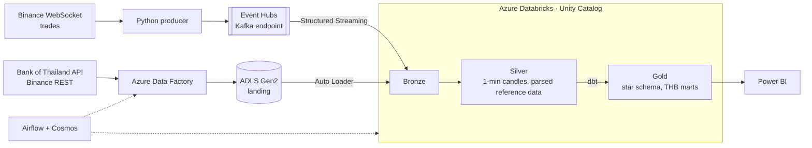
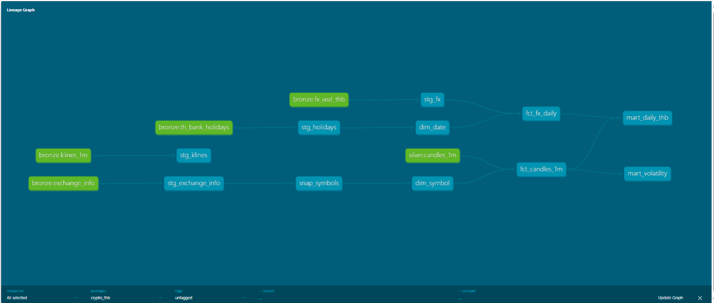

# Crypto Market Lakehouse (in THB) on Azure Databricks

Streaming and batch lakehouse for crypto market data, priced in Thai baht. Live trades from Binance go through Kafka (the Azure Event Hubs Kafka endpoint) into Databricks Structured Streaming and become 1-minute candles. Daily jobs in Azure Data Factory bring in the Bank of Thailand USD/THB rate and bank holidays, plus Binance reference data and official candles. Everything lands in a Bronze/Silver/Gold Delta lakehouse governed by Unity Catalog; dbt builds the Gold star schema, Airflow with Cosmos orchestrates the whole flow, and Power BI reads the result.

> **Status: in progress.** Infrastructure, streaming, batch ingestion and the dbt Gold layer are running. Reconciliation, orchestration, CI/CD and Power BI are next; see [Progress](#progress).

## Architecture



- **Streaming:** producer → Event Hubs → Bronze (raw messages) → Silver (deduplicated, event-time 1-minute candles with a watermark). Runs as scheduled `availableNow` jobs instead of an always-on cluster.
- **Batch:** parameterized ADF pipelines copy API responses as-is into ADLS; Auto Loader picks up only new files.
- **Gold (dbt):** SCD Type 2 symbol dimension, incremental candle fact, date dimension with Thai bank holidays, USD/THB rate forward-filled over holidays, daily THB marts, volatility, and stream-vs-exchange reconciliation.
- **Orchestration:** Airflow runs ADF and Databricks jobs; dbt runs through Cosmos when the batch data has landed (Airflow Assets).
- **Governance:** Unity Catalog grants per layer, lineage, tags; secrets in Key Vault and Databricks secret scopes; managed identities instead of storage keys.
- **Infrastructure and delivery:** Terraform for all Azure resources; GitHub Actions runs tests and `dbt build` on every pull request and deploys Databricks Asset Bundles from `main`.

## Data sources

Checked before starting, so the pipeline is not built on a source that returns placeholder data.

| Source | What | Access | Checked |
|---|---|---|---|
| Binance WebSocket `data-stream.binance.vision` | Every trade, real time | Public, no key | 96 BTCUSDT trades in 10 seconds |
| Binance REST `exchangeInfo`, `klines` | Symbol status and rules, official 1-minute candles | Public, no key | |
| Bank of Thailand `Stat-ReferenceRate/v2/DAILY_REF_RATE/` | Daily weighted-average interbank USD/THB rate | Free token from [portal.api.bot.or.th](https://portal.api.bot.or.th/), `Authorization` header | `data_detail[{period, rate}]`, business days only: 1–9 Oct 2026 returned 7 rates (33.558–33.662), weekends absent |
| Bank of Thailand `financial-institutions-holidays/?year=` | Thai bank holidays | Same portal, separate token | 20 holidays for 2026 under `result.data`, including 16 Oct, a Bangkok-only special holiday announced mid-year |

Two things the checks changed in the design:

- The FX rate exists only on business days, so Gold carries the last published rate forward over weekends and holidays (for example 13 Oct 2026).
- Holidays can be added during the year, so the holiday list is fetched again instead of loaded once.

## Account constraints

Built on an Azure for Students subscription, which limits what can be created:

- Region `eastasia`: the allowed regions are East Asia, Central India, Korea Central, Malaysia West and Indonesia Central, and Azure Databricks does not run in the last two.
- 6 vCPUs per region, and only older VM families have quota (4 vCPUs each for DSv2, DSv3, Dv3 and DDSv4; v5 requests are refused), so Databricks runs one 4-core single-node cluster at a time (`Standard_D4ds_v4`). The dev cluster has to be stopped before a job cluster can start.
- The Databricks `trial` SKU is refused on this subscription type, so the workspace is `premium` (also needed for Unity Catalog) and DBUs are paid from credit from the first hour.
- Credit ends on 17 Dec 2026; everything is created with Terraform so it can be destroyed and rebuilt.

## What's built so far

### Infrastructure (`terraform/`)

Resource group in `eastasia` with ADLS Gen2 (`landing` and `lakehouse` containers), Event Hubs Standard (topic `trades`, 3 partitions, 3-day retention, separate send and listen rules), Key Vault with RBAC, Data Factory and Databricks with managed identities. No storage keys anywhere: Data Factory and the Databricks access connector get Storage Blob Data Contributor, and Data Factory reads the Bank of Thailand tokens from Key Vault. Event Hubs and Databricks sit behind `create_eventhubs` / `create_databricks` flags so they only cost money while they are needed.

### Producer (`producer/`, `docker-compose.yml`)

Python producer on the Binance combined trade stream for BTC, ETH, SOL, BNB and XRP, keyed by symbol, with reconnect and backoff. It was built against a local single-node Kafka (KRaft, with kafka-ui) first; setting `EH_CONNECTION_STRING` switches the same code to Event Hubs over SASL_SSL.

- 4.5k–7.6k trades per minute.
- Partition 0 is hot: with librdkafka's key hashing, BTCUSDT and ETHUSDT both land there. Java clients hash differently, so the same keys spread another way.
- Binance trade time to Event Hubs: **median 141 ms, p99 364 ms, max 1.5 s**. A few values were negative because the local PC clock runs about 30–50 ms behind Binance.

### Streaming (`databricks/src/bronze_trades.py`, `silver_candles.py`)

A Databricks Asset Bundle job (`stream_bronze_silver`) on a single-node job cluster, run with `availableNow` instead of an always-on cluster:

- **Bronze** `crypto.bronze.trades`: raw Kafka payload plus partition, offset and enqueue time. The checkpoint makes reruns pick up only new offsets; the first run loaded 177,314 trades (81 minutes) and a rerun added only the 2,338 that arrived in between.
- **Silver** `crypto.silver.candles_1m`: parsed trades, deduplicated on `(symbol, trade_id)` within a 30-second watermark, grouped into event-time 1-minute OHLC candles. Open and close come from min/max of `(trade_time, trade_id, price)`, so ties in the same millisecond still pick one trade. The newest minute stays open until the watermark passes it, so it is written on the next run.
- Binance messages have both `t` (trade id) and `T` (trade time), so the parser turns on `spark.sql.caseSensitive`.

### Batch ingestion (`adf/`, `databricks/src/landing_to_bronze.py`)

Data Factory copies API responses into `landing/<source>/ds=YYYY-MM-DD/` unchanged:

- `pl_ingest_daily(day, symbols)`: USD/THB with a 7-day lookback (so holidays and late publication are covered), Binance `exchangeInfo`, and official 1-minute klines for every symbol (two pages per day, 1000 + 440 candles).
- `pl_ingest_holidays(year)`: the Thai bank holiday list.

Auto Loader (`landing_to_bronze` job) loads each new file as one row (`payload`, `source_file`, `ds`) into `crypto.bronze.fx_usd_thb`, `th_bank_holidays`, `exchange_info` and `klines_1m`. A rerun adds 0 files because the checkpoint remembers file names. It uses directory listing: file events need a storage queue, which failed with 403 on this subscription, and listing is cheap for a folder this small.

Data Factory isn't Git-linked, so the JSON in `adf/` is exported from the published factory.

### dbt: Silver staging and Gold (`dbt/`)

dbt-databricks runs against the dev cluster. `dbt build` passes: one snapshot, 10 models, tests on every Gold table.



- **Sources and freshness:** the stream table errors after 13 hours without new candles, the FX rate warns after 4 days (long holiday weekends). It caught the stream being paused overnight.
- **Silver staging views** parse the raw JSON with `payload:field`, `from_json` and `explode`, and keep only the newest copy of each file or date (the FX request looks back 7 days, so every date arrives several times).
- **SCD Type 2 snapshot** of each symbol's trading rules (`strategy: check`, since exchangeInfo has no updated-at field). `dim_symbol` starts the first version in 1970 so candles from before the first snapshot still join.
- **`fct_fx_daily`** has a rate for every calendar day: weekends and Thai bank holidays carry the last published rate forward, and `is_published` says which days are real. In the data so far, 13 Oct (holiday) uses 12 Oct's rate and 16–18 Oct use 15 Oct's.
- **`fct_candles_1m`** is incremental with merge on `(symbol, minute_start)`, filtered by `processed_at` rather than `minute_start`: the watermark holds back the last minute of every stream run, so that candle arrives in the next run with an older timestamp and a `minute_start` filter would drop it. Each candle joins the symbol version that was valid at that minute.
- **Marts:** daily prices in THB by Thai date (a stream run from 20:44 to 00:31 Bangkok time splits into two days), VWAP, and rolling 60-minute volatility.
- Assumption: 1 USDT = 1 USD. USDT is a stablecoin that moves slightly around 1 USD, so THB prices carry that small error.
- Found while building: the first daily ADF run for 17 Oct ran at 00:23 Bangkok time, when the UTC day still had 6.5 hours to go, so that day's official candles stop at 17:23 UTC. Daily jobs have to wait for the UTC day to close.

## Planned data model (Gold)

```
                 dim_symbol (SCD Type 2)
                 status, tick size, base/quote asset
                          │
dim_date ─────── fct_candles_1m ─────── fct_fx_daily
(Thai bank        symbol, minute,        USD/THB, forward-filled
 holidays)        OHLC, volume, trades   over weekends and holidays
```

## Data quality plan

- **Stream vs exchange reconciliation:** compare every candle built from the stream with Binance's official candle for the same minute, and explain the minutes that differ (disconnects, late events past the watermark, duplicates).
- Freshness checks on the stream and the FX rate; dbt tests on every layer.
- Failure experiments: pause Databricks for a day (expected: nothing lost, Event Hubs retains 3 days) and stop the producer for a few minutes (expected: a gap the checks catch).

## Progress

- [x] Terraform: ADLS Gen2, Event Hubs, Key Vault, Data Factory, Databricks
- [x] Producer: local Kafka, then Event Hubs
- [x] Unity Catalog: medallion schemas, external locations
- [x] Streaming: Bronze and Silver candles
- [x] ADF ingestion and Auto Loader
- [x] dbt Gold: star schema, SCD2, tests
- [ ] Reconciliation, governance, cost measurements
- [ ] Airflow + Cosmos orchestration
- [ ] CI/CD with GitHub Actions and Asset Bundles
- [ ] Power BI report

## Stack

Azure (ADLS Gen2, Event Hubs, Data Factory, Key Vault) · Azure Databricks (Spark Structured Streaming, Delta Lake, Auto Loader, Unity Catalog, Asset Bundles) · Apache Kafka protocol · dbt · Apache Airflow + Cosmos · Terraform · GitHub Actions · Power BI · Python · SQL
